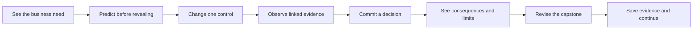
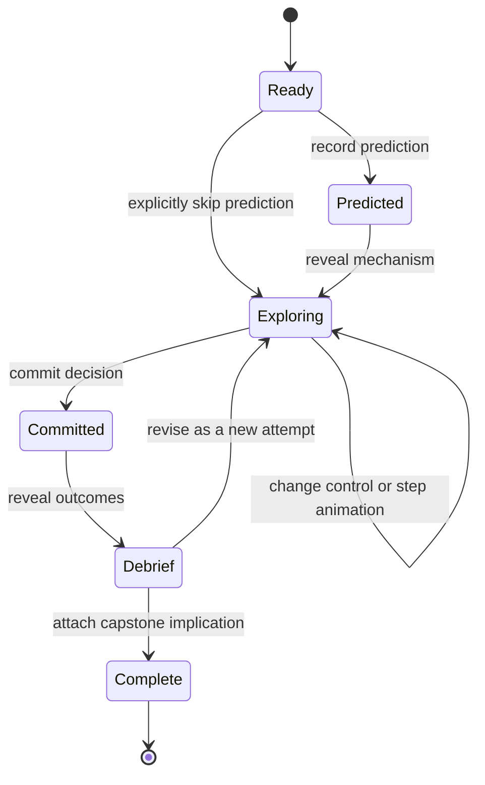
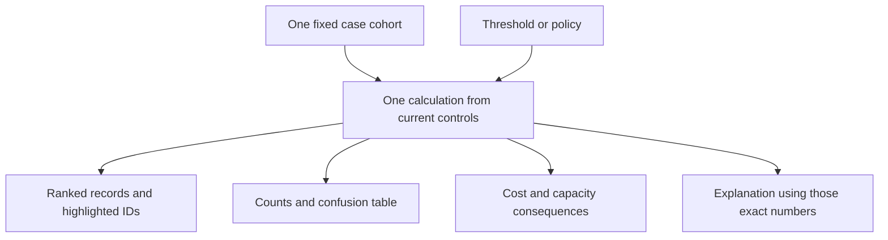
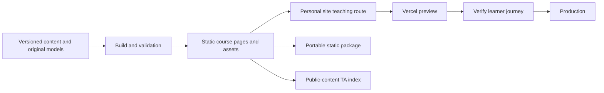

# Building an original interactive business course

This is a proposed implementation handbook for Majid Memari, distilled from the [reference study](README.md). It describes how to achieve comparable instructional depth with original cases. It does **not** describe the reference application's hidden architecture. A Vercel hostname, rendered chart, or client-side interaction does not reveal its repository, database, framework, deployment process, or authoring tools.

## 1. Design a decision before designing a screen

Start with one decision a business learner should make better. Write the decision, its owner, the available evidence, the constraints, and the cost of being wrong. Then choose a misconception that the learner can see fail. A working example:

> A service manager must decide which requests an AI assistant may resolve automatically, which need human review, and whether a limited pilot creates enough value to continue.

The learning target is a defensible operating policy. A threshold slider is only useful if moving it changes review workload, missed exceptions, cost, and the learner's recommendation. A beautiful figure with no consequential question does not meet this target.

For every activity, complete this contract before implementation:

| Field | Required answer |
|---|---|
| Decision | What must the learner choose or recommend? |
| Misconception | What plausible but incomplete belief will the activity expose? |
| Data | Which original or appropriately licensed records support the demonstration? |
| Stable comparison | Which cohort, sample, seed, or period remains fixed? |
| Control | What one factor changes first? |
| Representations | Which chart, table and number show the same underlying result? |
| Consequence | What operational, financial, customer or risk outcome changes? |
| Feedback | What explanation depends on the learner's actual action? |
| Transfer | What must the learner change in their capstone afterward? |
| Evidence limit | What does this illustration not establish? |

## 2. Use a small learning loop inside one course path

The reference's three-stage structure can be translated into the existing **Learn → Try → Build → Finish** path without adding a second navigation system.



**Learn:** scenario and one mechanism, explained with a small example. **Try:** the embedded simulation and a short check. **Build:** an analogous choice for the learner's partner or fallback case. **Finish:** a short evidence checklist and one obvious next-unit link.

The twelve-unit route remains the organizing structure. Topic jumps and optional explanations are secondary aids, never competing required routes. Avoid adding a standalone lab suite merely because the reference has one. That would conflict with the user's requested simplicity.

## 3. Author a scene as a state machine

Separate what the learner has done from what the interface currently displays. Keep actions explicit and testable.



Proposed state, not reference source:

```text
activityState = {
  activityId, schemaVersion, datasetVersion,
  stage, prediction, controls, selectedRecordId,
  stepIndex, playing, seed,
  committedDecision, resultRevealed,
  checks: {questionId: {choice, feedbackSeen}},
  reflection, attempts
}
```

Derive the results from data plus controls. Do not separately store independent chart totals, table totals and caption totals; they will drift. A single calculation should return counts, costs, selected IDs, chart-ready values and an explanation key. Render each view from that result.

For asynchronous calculations, associate each result with the settings/version that produced it. Show a pending state instead of old values beneath new settings; discard stale responses. Update the final chart/table/caption values atomically. If numbers animate, animate only presentation and keep the underlying result consistent.

**Reset contracts:** distinguish resetting a chart, drawing a new sample, revising a decision, and deleting all local work. Name buttons accordingly. A reset of one activity must not erase the capstone. When the learner switches views, keep their place and controls. For saved work, version the schema and provide export/import rather than relying on one browser forever.

## 4. Build the linked-view pattern once

The strongest repeated reference pattern is a common set of records represented several ways. For example:



Implementation sequence:

1. Write a pure calculation independent of the UI. Give the records stable IDs.
2. Check the calculation with a hand-countable dataset.
3. Render a semantic table first. It becomes both an audit surface and a fallback.
4. Add a chart with the same IDs, units and denominators.
5. Connect one control to every representation.
6. Add a caption that names what changed, what stayed fixed, and why it matters.
7. Add the business decision and a comparison with a baseline.

For threshold tasks, the invariant `TP + FP + FN + TN = N` must hold at every setting. If no records are selected, precision is undefined, not zero. Costs require explicit units and periods. A percentage must identify its denominator. Keep estimates, observed outcomes and simulated counterfactuals visually and verbally distinct.

See the [complete six-record worked example](WORKED_EXAMPLE.md) for input data, calculation, exact outputs, figure/caption contract, feedback and expected checks. For an actual predictive workflow, select models and operating policies using training/validation evidence and reserve a final test set for evaluation. Check calibration before treating an ensemble score as a probability in a cost-based cutoff.

## 5. Make animation explain a transformation

Useful animations in the reference expose intermediate states: assigning records to groups, moving centers, selecting a tree split, drawing bootstrap samples, adding votes, fitting residuals, shrinking a candidate subset, or making one random isolation cut.

A reusable animation controller should support `Step`, `Play/Pause`, `Finish`, and `Reset this demonstration`. Each frame is a real algorithmic state with a short explanation. Do not animate arbitrary interpolation while showing a number that belongs to the final frame.

Recommended implementation:

```text
frames = buildTeachingFrames(originalData, settings, seed)
visibleFrame = frames[state.stepIndex]
render(visibleFrame)
caption(visibleFrame.event, visibleFrame.numbers)
```

Store or deterministically regenerate frames. A timed play loop advances the same index as the Step button. Cancel pending timers on reset, route change and unmount. A new run must not inherit a pending callback from an old one. Provide a reduced-motion mode that uses immediate state changes and preserves every explanatory step. Keep persistent old positions as outlines or dashed connectors when the movement itself teaches something.

Use a fixed seed when comparing a setting. Offer a separately labeled new sample/seed action when variability is the lesson. Report trial count and denominator. For consequential simulations, keep the same cohort and outcome assumptions across competing policies.

## 6. A compact component inventory

| Reusable component | Contract | Good use |
|---|---|---|
| Case brief | Decision, role, data, limits, time estimate | Remind learners what they are trying to accomplish |
| Concept section | Heading, misconception, action, evidence, implication | One mechanism per section |
| Definition card | Term and short plain-language meaning | Vocabulary immediately before use |
| Linked figure | Chart + control + table/summary + derived caption | One calculation, several views |
| Step controller | Current step, total steps, next event, reset | Make an algorithm inspectable |
| Metric tile | Value, unit, denominator/period, baseline | Show magnitude without losing meaning |
| Semantic legend | Color + shape/line + label | Explain categories and selected states |
| Optional depth | Disclosure after intuition | Formulas and method limitations |
| Check card | Commitment, correct/wrong labels, explanation, retry policy | Expose a misconception without punishing exploration |
| Decision gate | Explicit choice, constraints, saved commitment | Prevent hindsight from replacing reasoning |
| Debrief | Decision, outcomes, baseline, tradeoff, uncertainty | Connect statistical output to business judgment |
| Transfer prompt | Capstone artifact and quality criterion | Turn practice into project progress |

Avoid creating a new component for every chart. Keep chart-specific computation separate from shared axes, legends, controls and feedback cards. Keep scenarios as data/content where practical. Use ordinary HTML for explanations so they remain readable, searchable, printable and available to the course TA.

## 7. Original visual system

Use the user's current cream/navy/teal system across personal site, lessons, course TA, website chatbot, and workshop surfaces. The [visual design notes](VISUAL_DESIGN.md) explain the reference's hierarchy and how to translate it without duplicating its brand.

Color is a semantic contract within a figure. Blue/teal can identify a baseline, coral can identify an exception or changed model, and amber can identify the current selection—but those roles must be chosen explicitly. Never make one color mean both a true outcome and a policy action on the same plot. Use outlines, fill, shapes or row shading for the second dimension. Labels and numbers must carry the meaning if colors are removed.

Place chart instructions before the figure; place the current interpretation immediately after it. Explain axes, unit, data source and what one mark represents. If a panel uses a different vertical scale, label that scale directly and explain why. Plot uncertainty around a forecast; do not use a confidence-looking band for decoration.

## 8. Proposed repository organization

The current course already has a source/build/public separation; improve that structure incrementally instead of replacing it with an unnecessary framework migration.

```text
course root/
  README.md                         # entry point and current status
  INSTRUCTIONAL_DESIGN_PLAN.md       # outcomes and learning sequence
  AI_REVIEW_BRIEF.md                 # independent review contract
  docs/reference-study/             # this original design research
  site/
    course_content.py              # current lesson/capstone content
    visual_lessons.py              # accessible figure explanations
    build_core.py                  # course rendering
    assets/
      practice.js                  # existing activity models and controls
      lesson-figures.js            # existing inline figures
      core.css                    # shared visual system
    tests/ or current test files   # calculation and behavior checks
    dist/                          # generated; never hand edited
  private/                         # ignored; never a public build input
```

If the interaction code grows, introduce clearly owned modules for datasets, calculations, state transitions and views. Keep the active file map current. Do not reorganize solely for fashion: a new agent should be able to trace `lesson → activity → calculation → test → generated route` in minutes.

For each new simulation, version a design contract, original dataset provenance, assumptions, model calculation, test fixtures, feedback rules, and a walkthrough. Historical research and deployment screenshots must not become runtime or TA inputs.

## 9. Course TA and website chatbot

Keep the two assistants separate. The course TA receives public lesson evidence, the current lesson/activity identifier, and optionally a learner-selected summary of the current calculation. The website chatbot handles course/workshop discovery and inquiries. Neither should silently ingest private capstone notes or partner records.

The existing course retrieval build reads an allowlist of public lesson HTML; it does not execute every interactive model. Therefore write essential definitions, assumptions, examples and limitations into the readable lesson, and test whether the TA can cite them. If live state is shared, send a small, explicitly defined payload such as threshold, cohort size and derived counts, label it as learner state, and keep it separate from retrieved source text. Do not let the assistant invent a chart result from a lesson title.

The page remains usable if the assistant is unavailable. Its styling and navigation stay inside the course. Provide source links and uncertainty; do not use the chatbot as the only place where required instructions or feedback exist.

## 10. Hosting on Vercel without binding the content to it

This is a proposed deployment pattern, not a reverse-engineered claim about the reference:



Use the personal website's existing teaching route and theme. Keep static lessons and client-side simulations portable; use server routes only for features that need them, such as the course TA and inquiry delivery. Keep service credentials on the server. A standalone portable package must explicitly state which online features will be unavailable offline.

For each release, record the canonical source commit, generated file hashes, deployment commit/URL, exact verification performed, and known limitations. A preview working is not proof that production is current. Do not claim that data or messages persisted without checking the actual end-to-end flow. Read current platform guidance when performing a deployment; this handbook intentionally avoids brittle CLI commands.

## 11. Verification that matters

**Calculations:** hand-check small cases; check all/none selected, ties, zero denominators, missing fields, exact budget limits, invalid ranges and unit conversions. Verify a fair baseline uses the same records and period. Compare stochastic outputs with deterministic fixtures and statistical expectations appropriate to the exercise.

**Interactions:** inspect each finite section, each control family, representative boundary states, both feedback paths, stage navigation, reset, interrupted animations and saved-state restoration. A changed input value alone is not evidence that its outputs updated. Verify the chart, table and caption.

**Accessibility:** complete an activity with keyboard alone. Check visible focus, input labels, disabled-state explanations, figure alternatives, non-color meaning, headings, readable feedback announcements, zoom and narrow layouts. An SVG label is useful but does not by itself make individual chart interactions accessible. Provide table/button alternatives to point selection.

**Instructional quality:** ask learners to predict before changing a control, explain why a result changed, and apply it to a new case. Measure time, confusion and transfer. Technical test passes do not show that students learned.

**Numerical honesty:** label synthetic data, rounded arithmetic, toy models, assumed effects, estimates and causal limitations. A polished reference may still contain mistakes. Validate subject-matter claims independently before using them in lessons.

## 12. A practical authoring sequence

1. Choose one capstone decision and draft its contract.
2. Create a hand-countable original example and an optional larger case.
3. Write the plain-language explanation, figure caption and baseline comparison.
4. Implement and independently verify the pure calculation.
5. Build one linked interactive figure, then add the decision/debrief loop.
6. Add optional depth and targeted misconception feedback.
7. Add keyboard alternatives, narrow layout and reduced-motion behavior.
8. Connect the activity to the existing unit and capstone evidence.
9. Check TA retrieval of the activity's public assumptions and limitations.
10. Run source, browser and representative-learner reviews, then release with evidence.

For the next iteration, prioritize depth in the existing inline simulations over increasing their count. One carefully explained, consequential activity per important decision is more useful than a dashboard full of disconnected controls.
